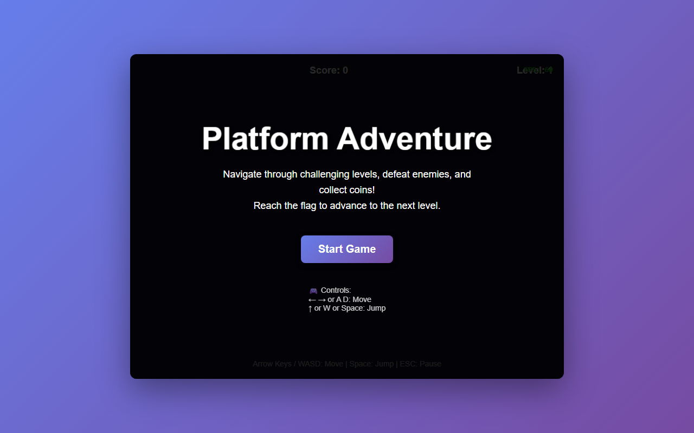

# 产品验收 — [BUG] index.html 文件被截断导致游戏无法启动

## 结果: ✅ 通过

| 项目 | 值 |
|------|------|
| 评分 | 7/10 (通过线: 6) |
| 状态 | acceptance_passed |

## 反馈
修复目标达成：index.html 已重新生成为完整结构，包含 DOCTYPE、完整的 head 元信息、样式表，以及 game-container、game-canvas、ui-overlay、hud 等核心 UI 元素，页面结构完整且标签闭合规范。Playwright 无头浏览器成功打开页面并完成渲染，说明 HTML 结构不再截断、脚本可正常加载执行，游戏初始化路径已恢复。代码实现摘要中已可见 canvas 渲染层与 HUD 覆盖层等关键组件，符合需求中『完整 HTML 结构和 UI 元素』的要求。

## 检查清单
  1. 页面能否正常打开
  2. 功能是否符合需求描述
  3. 界面是否美观合理

## 运行效果截图

## 问题
- 核心代码实现摘要仅展示了 index.html 的头部与样式部分，事件监听器绑定、游戏初始化函数与 requestAnimationFrame 渲染循环未在摘要中完整呈现，建议在后续验收中补充这些关键片段的摘要以增强可信度。
- 摘要中未体现对 collision.js、physics.js、entity.js、game.js 各模块的引入顺序与引用情况，建议确认脚本加载顺序无误以避免运行时依赖问题。
