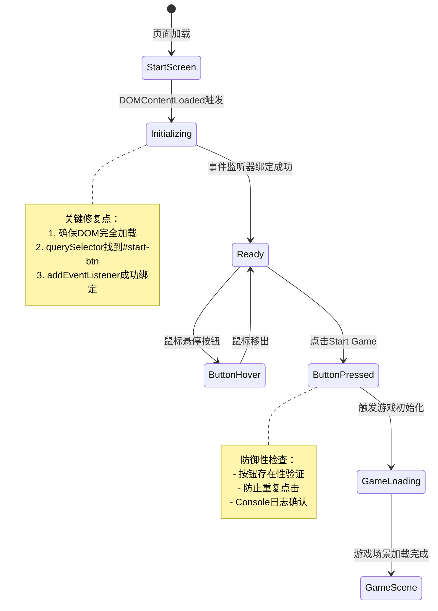

# UX 设计 — [BUG] Start Game 按钮点击无响应 - 事件监听器未绑定

> 所属需求：[BUG修复] Start Game 按钮点击无响应 - 事件监听器未绑定

## 交互流程图


```

## 组件线框说明

## 开始界面结构

### 主容器 (#start-screen)
- 垂直居中布局
- 包含标题区和按钮区

#### 1. 标题区域
- 游戏标题文本："Platform Adventure"
- 位置：容器上半部分
- 层级：z-index 高于背景

#### 2. 按钮区域
- **Start Game 按钮** (#start-btn)
  - 类型：主要操作按钮（Primary CTA）
  - 位置：标题下方，垂直居中对齐
  - 尺寸：足够大的点击区域（建议最小 44x44px）
  - 内容：文本 "Start Game"

### DOM 结构要求
```html
<div id="start-screen">
  <h1>Platform Adventure</h1>
  <button id="start-btn">Start Game</button>
</div>
```

### 关键修复点
- 确保 `#start-btn` 元素在 HTML 中存在
- 按钮必须在 DOMContentLoaded 之前渲染完成
- 按钮不能被其他元素遮挡（z-index 检查）

## 交互状态定义

## Start Game 按钮状态

### 1. 默认状态 (normal)
- 显示 "Start Game" 文本
- 可点击，cursor: pointer
- 正常不透明度

### 2. 悬停状态 (hover) - Web端
- 视觉反馈：轻微高亮/缩放效果
- 鼠标指针变为 pointer
- 过渡动画：0.2s ease

### 3. 按下状态 (active)
- 按下瞬间：scale(0.95)
- 视觉反馈：亮度降低或阴影变化
- 持续时间：按住期间

### 4. 禁用状态 (disabled) - 游戏加载中
- opacity: 0.5
- cursor: not-allowed
- 不响应点击事件
- 显示时机：点击后到游戏场景加载完成前

### 5. 加载状态 (loading) - 可选增强
- 文本变为 "Loading..."
- 或显示 spinner 图标
- 防止重复点击
- 持续时间：游戏初始化过程

## 页面级状态

### 初始化状态
- **未就绪**：按钮不可点击（事件未绑定）
- **就绪**：按钮可点击（事件监听器绑定成功）
- **过渡中**：按钮点击后，等待游戏场景加载

### 错误状态（防御性）
- 如果 `#start-btn` 未找到：Console 输出警告
- 如果游戏初始化失败：显示错误提示 + 重试按钮

## 调试状态（开发阶段）
- Console 日志："Start button initialized"
- Console 日志："Start button clicked"
- Console 日志："Game scene loading..."

## 响应式/适配规则

## 响应式断点

### Mobile (< 768px)
- 按钮宽度：80% 容器宽度，最小 200px
- 按钮高度：48px（符合移动端最小点击区域）
- 标题字号：相对单位（em/rem）自适应
- 垂直间距：标题与按钮间距 32px

### Tablet (768px - 1024px)
- 按钮宽度：固定 280px
- 按钮高度：56px
- 标题与按钮间距：48px

### Desktop (> 1024px)
- 按钮宽度：固定 320px
- 按钮高度：64px
- 标题与按钮间距：64px
- 支持 hover 状态交互

## 触摸优化（移动端）
- 按钮点击区域：最小 44x44px（iOS 人机界面指南）
- 取消 hover 状态（移动端无意义）
- active 状态替代 hover：触摸时立即反馈
- 防止双击缩放：touch-action: manipulation

## 横竖屏适配
- 竖屏（portrait）：标题在上，按钮在下，垂直居中
- 横屏（landscape）：保持相同布局，调整间距比例

## 关键修复无关响应式
本次 BUG 修复主要是 JavaScript 事件绑定问题，与响应式布局无关。但需确保：
- 按钮在所有断点下都能正确渲染
- 事件监听器在所有设备上都能成功绑定

## UI 资产清单（初稿）

## 图标资产

### 1. 加载图标（可选增强）
- **用途**：按钮 loading 状态显示
- **规格**：24x24px，SVG 格式
- **风格**：旋转动画的 spinner，与游戏主题匹配
- **颜色**：单色（CSS 可控）
- **文件名建议**：`icon-spinner.svg`

### 2. 成功图标（可选增强）
- **用途**：游戏成功加载后的临时反馈
- **规格**：24x24px，SVG 格式
- **风格**：勾选标记（checkmark）
- **文件名建议**：`icon-check.svg`

## 插画资产

### 1. 游戏标题背景（可选）
- **用途**：开始界面背景装饰
- **描述**：平台跳跃游戏风格的像素艺术或简约场景
- **尺寸**：1920x1080（全屏背景）
- **格式**：PNG/WebP（支持透明度）
- **文件名建议**：`bg-start-screen.png`

## 图片资产

### 1. 游戏 Logo（可选）
- **用途**：替代纯文本标题
- **尺寸**：建议 400x120（宽高比 10:3）
- **格式**：PNG（透明背景）或 SVG
- **文件名建议**：`logo-platform-adventure.png`

## 字体资产

### 1. 游戏主字体
- **用途**：标题和按钮文本
- **风格建议**：像素字体（如 Press Start 2P）或游戏风格无衬线字体
- **格式**：WOFF2（Web 优化）
- **备用方案**：系统字体 fallback（sans-serif）

## 音效资产（可选增强）

### 1. 按钮点击音效
- **用途**：Start Game 按钮点击反馈
- **时长**：< 0.5s
- **格式**：MP3/OGG
- **文件名建议**：`sfx-button-click.mp3`

---

## 本次修复所需资产
**最小化方案**（仅修复 BUG）：
- ❌ 无需新增任何 UI 资产
- ✅ 仅需修复 JavaScript 事件绑定逻辑

**增强方案**（改善用户体验）：
- ✅ 加载图标（spinner）：显示游戏初始化进度
- ✅ 按钮点击音效：增强交互反馈
