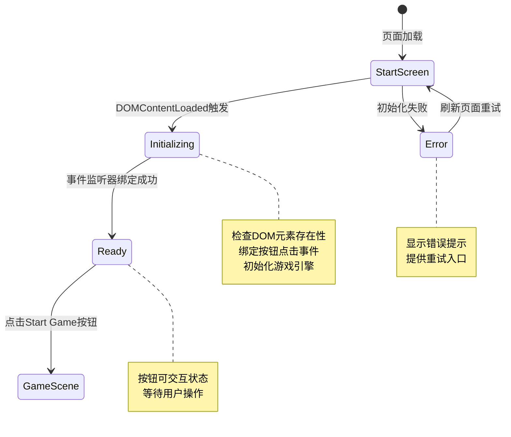

# UX 设计 — [BUG] Start Game 按钮点击无响应 - 事件监听器未绑定

> 所属需求：[BUG修复] Start Game 按钮点击无响应 - 事件监听器未绑定

## 交互流程图


```

## 组件线框说明

## 开始界面结构

### 主容器 (#start-screen)
```
┌─────────────────────────────────────┐
│         [游戏标题区域]              │
│     Platform Adventure              │
│                                     │
│         [按钮区域]                  │
│       ┌───────────────┐             │
│       │  Start Game   │ (#start-btn)│
│       └───────────────┘             │
│                                     │
│         [版本信息]                  │
│          v0.1.0                     │
└─────────────────────────────────────┘
```

### 组件层级
- **容器层**：全屏居中容器，垂直布局
- **标题层**：游戏名称文本
- **交互层**：Start Game 按钮（主要交互元素）
- **信息层**：版本号/版权信息（次要信息）

### 关键元素
- `#start-btn`：主操作按钮，触发游戏开始
- 按钮需要明确的视觉焦点（最大视觉权重）
- 无其他干扰元素，保持界面简洁

## 交互状态定义

## Start Game 按钮状态

### 1. 默认状态（normal）
- 按钮可见且可点击
- 显示完整文本 "Start Game"
- 具有明确的可点击视觉暗示

### 2. 悬停状态（hover）- Web端
- 鼠标悬停时触发
- 视觉反馈：轻微放大（scale 1.05）或亮度提升
- cursor: pointer
- 过渡动画：150ms ease-out

### 3. 按下状态（active）
- 鼠标按下或触摸时触发
- 视觉反馈：缩小（scale 0.95）
- 亮度降低或添加内阴影效果
- 过渡动画：100ms ease-in

### 4. 禁用状态（disabled）
- 游戏初始化未完成时
- opacity: 0.5
- cursor: not-allowed
- 不响应任何点击事件
- 可选：显示加载指示器

### 5. 加载状态（loading）
- 点击后到游戏场景加载完成期间
- 按钮文本变为 "Loading..." 或显示 spinner
- 禁止重复点击（防抖处理）
- 可选：显示加载进度百分比

### 6. 错误状态（error）
- 游戏初始化失败时
- 按钮文本变为 "Retry" 或 "Error - Click to Retry"
- 可选：红色边框提示
- 点击后重新执行初始化流程

## 页面级状态

### 初始化中（Initializing）
- 显示加载指示器（可选）
- Start Game 按钮禁用
- 可选：显示 "Initializing..." 提示文本

### 就绪状态（Ready）
- Start Game 按钮启用
- 所有交互状态正常响应
- 无错误提示信息

### 错误状态（Error）
- 显示错误提示信息（Toast 或内联文本）
- 提示内容："Failed to initialize game. Please refresh."
- 提供刷新页面或重试按钮
- Start Game 按钮变为 Retry 状态

### 空状态（不适用）
- 此界面无数据加载，不存在空状态

## 响应式/适配规则

## 断点定义
- **Mobile**: < 768px（手机竖屏/横屏）
- **Tablet**: 768px - 1024px（平板）
- **Desktop**: > 1024px（桌面浏览器）

## 布局适配规则

### Mobile (< 768px)
- 全屏垂直居中布局
- 标题字号：相对单位（适配小屏）
- 按钮宽度：80% 容器宽度，最小 200px
- 按钮高度：48px（符合触摸目标最小尺寸）
- 垂直间距：标题与按钮间距 40px
- 触摸优化：按钮周围留足空白（防误触）

### Tablet (768px - 1024px)
- 垂直居中布局保持
- 标题字号：略大于 Mobile
- 按钮宽度：固定 300px 或 60% 容器宽度（取较小值）
- 按钮高度：56px
- 垂直间距：标题与按钮间距 60px
- 支持鼠标悬停效果

### Desktop (> 1024px)
- 垂直居中布局
- 标题字号：最大尺寸
- 按钮宽度：固定 320px
- 按钮高度：64px
- 垂直间距：标题与按钮间距 80px
- 完整鼠标交互效果（hover/active）

## 交互适配
- **Mobile/Tablet**: 禁用 hover 效果，仅保留 active 状态
- **Desktop**: 完整 hover + active 状态
- **触摸设备**: 按钮最小触摸区域 44x44px（iOS 规范）

## 方向适配
- **竖屏（Portrait）**: 默认布局
- **横屏（Landscape）**: 保持垂直居中，可适当缩小间距

## 性能考虑
- 使用 CSS 媒体查询实现响应式
- 避免 JavaScript 监听 resize 事件
- 动画使用 transform（GPU 加速）而非 width/height

## UI 资产清单（初稿）

## 图标资源（Icons）
- **无需图标**：当前界面为纯文本按钮，无图标需求
- **可选优化**：按钮内添加 play 图标（▶️，16px，solid 风格，按钮文本左侧）

## 插画资源（Illustrations）
- **无需插画**：开始界面为极简设计，无插画需求
- **可选优化**：背景装饰性插画（游戏主题相关，如平台/角色剪影，全屏背景，低透明度）

## 图片资源（Images）
- **背景图**（可选）：
  - 用途：开始界面背景
  - 尺寸：1920x1080（适配桌面），提供 @2x 版本
  - 格式：WebP（优先）或 JPG
  - 要求：低饱和度/模糊处理，不干扰前景文本可读性

- **Logo 图**（可选）：
  - 用途：替代文本标题 "Platform Adventure"
  - 尺寸：400x120（宽高比约 3:1）
  - 格式：SVG（矢量）或 PNG（透明背景）
  - 要求：高对比度，适配深色/浅色背景

## 动效资源（Animations）
- **按钮点击反馈**：CSS transition 实现，无需额外资源
- **加载动画**（可选）：
  - Spinner 或进度条
  - 使用 CSS 动画或 SVG 动画
  - 颜色：与按钮主色一致

## 字体资源（Fonts）
- **标题字体**：粗体/加粗，游戏风格字体（如 Press Start 2P / Orbitron）
- **按钮字体**：中等粗细，清晰易读
- **备用字体栈**：sans-serif 系统字体

## 音效资源（Audio）- 游戏相关
- **按钮点击音效**：短促的确认音（50-100ms，格式：MP3/OGG）
- **背景音乐**（可选）：循环播放的轻音乐（格式：MP3，< 2MB）

## 当前 Bug 修复无需新增资源
- 本次修复为功能性 Bug（事件绑定问题）
- 无需新增任何 UI 资产
- 现有界面结构保持不变
