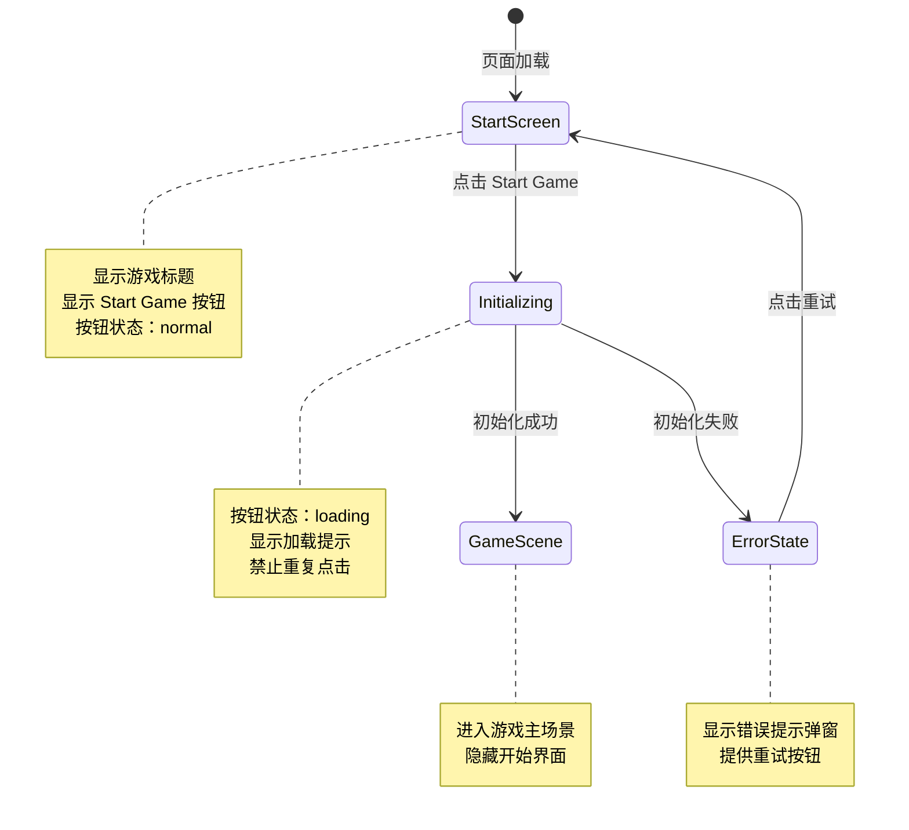

# UX 设计 — [BUG] Start Game 按钮点击无响应 - 事件监听器未绑定

> 所属需求：[BUG修复] Start Game 按钮点击无响应 - 事件监听器未绑定

## 交互流程图


```

## 组件线框说明

## 开始界面（Start Screen）

### 主要区域
1. **标题区域**（顶部居中）
   - 游戏标题文字：Platform Adventure
   - 位置：垂直居中偏上（40% 位置）

2. **交互区域**（中央）
   - Start Game 按钮
   - 位置：垂直居中偏下（60% 位置）
   - 尺寸：宽度 200-240px，高度 48-56px

3. **背景层**
   - 全屏背景色/渐变
   - 可选装饰性图形元素

### 组件结构
```
<开始界面容器>
  ├─ <标题文字>
  ├─ <按钮容器>
  │   └─ <Start Game 按钮>
  │       ├─ 按钮文字
  │       └─ 加载状态指示器（隐藏）
  └─ <错误提示弹窗>（隐藏）
      ├─ 错误图标
      ├─ 错误信息文字
      └─ 重试按钮
```

### 元素 ID/Class
- 按钮：`#start-btn`
- 标题：`.game-title`
- 错误弹窗：`.error-modal`（默认 display: none）
- 加载指示器：`.loading-spinner`（默认 display: none）

## 交互状态定义

## Start Game 按钮状态

### 1. 默认状态（normal）
- 可点击
- 显示文字「Start Game」
- 光标：pointer
- 视觉：实心背景 + 白色文字

### 2. 悬停状态（hover）- Web 端
- 背景亮度提升 10%
- 轻微放大效果（scale: 1.05）
- 过渡动画：0.2s ease

### 3. 按下状态（active）
- 缩小效果（scale: 0.95）
- 背景亮度降低 5%
- 过渡动画：0.1s ease

### 4. 加载状态（loading）
- 文字变为「Loading...」或隐藏
- 显示旋转的加载图标（spinner）
- 禁止点击（pointer-events: none）
- 透明度：0.8
- 持续时间：直到游戏初始化完成

### 5. 禁用状态（disabled）
- 透明度：0.5
- 光标：not-allowed
- 不响应任何交互事件
- 使用场景：游戏资源加载中、初始化失败时

### 6. 错误状态（error）
- 按钮恢复为默认状态
- 触发错误弹窗显示
- 按钮文字保持「Start Game」

## 错误提示弹窗状态

### 1. 隐藏状态（默认）
- display: none
- 不占据布局空间

### 2. 显示状态（error）
- 从下向上滑入 + fade in（200ms）
- 半透明遮罩层（rgba(0,0,0,0.5)）
- 弹窗居中显示
- 包含：错误图标 + 错误信息 + 重试按钮

### 3. 关闭动画
- fade out（150ms）
- 返回隐藏状态

## 重试按钮状态
- 继承 Start Game 按钮的所有交互状态
- 点击后：关闭弹窗 → 重新触发游戏初始化流程

## 响应式/适配规则

## 断点定义
- **Mobile**: < 768px
- **Tablet**: 768px - 1024px
- **Desktop**: > 1024px

## 响应式布局规则

### Mobile (< 768px)
- 标题文字：较小尺寸（相对单位）
- Start Game 按钮：
  - 宽度：80% 容器宽度（最大 280px）
  - 高度：48px
  - 触摸区域：最小 44x44px（符合移动端可点击区域标准）
- 错误弹窗：
  - 宽度：90% 容器宽度
  - 距离屏幕边缘：5% margin
- 取消 hover 效果（移动端无鼠标悬停）
- 保留 active 状态（触摸反馈）

### Tablet (768px - 1024px)
- 标题文字：中等尺寸
- Start Game 按钮：
  - 宽度：固定 240px
  - 高度：52px
- 错误弹窗：
  - 宽度：60% 容器宽度（最大 500px）
- 支持 hover 效果

### Desktop (> 1024px)
- 标题文字：最大尺寸
- Start Game 按钮：
  - 宽度：固定 240px
  - 高度：56px
- 错误弹窗：
  - 宽度：固定 480px
  - 居中显示
- 完整 hover + active 交互

## 通用规则
- 所有文字使用相对单位（rem/em）
- 按钮圆角：固定 8px（不随尺寸缩放）
- 间距使用百分比或 viewport 单位（vh/vw）
- 最小触摸区域：44x44px（移动端）
- 最小点击区域：32x32px（桌面端）

## UI 资产清单（初稿）

## 图标（Icons）

### 1. 加载图标（Loading Spinner）
- **用途**：按钮加载状态指示器
- **尺寸**：24x24px
- **风格**：圆形旋转动画，线条风格（stroke-width: 2-3px）
- **颜色**：白色（叠加在按钮上）
- **动画**：360° 旋转，1s 线性循环
- **格式**：SVG 或 CSS 动画

### 2. 错误图标（Error Icon）
- **用途**：错误弹窗顶部提示
- **尺寸**：48x48px
- **风格**：圆形感叹号或 X 图标，填充风格
- **颜色**：错误红色（语义化）
- **格式**：SVG

### 3. 重试图标（Retry Icon）- 可选
- **用途**：重试按钮左侧装饰
- **尺寸**：20x20px
- **风格**：循环箭头，outline 风格
- **颜色**：继承按钮文字颜色
- **格式**：SVG

## 插画（Illustrations）

### 无需插画
- 本界面为游戏开始界面，以简洁为主
- 背景可使用纯色/渐变/简单几何图形

## 图片（Images）

### 背景图（可选）
- **用途**：开始界面全屏背景
- **尺寸**：1920x1080px（16:9 比例）
- **格式**：WebP（优先）或 JPG
- **内容**：游戏主题相关的抽象背景或场景预览
- **优化**：压缩至 < 200KB

## 动效资产

### 按钮点击波纹效果（可选）
- **实现方式**：CSS 伪元素 + transform
- **持续时间**：0.6s
- **扩散范围**：从点击点向外扩散至按钮边缘

### 弹窗遮罩层
- **实现方式**：CSS background-color + opacity
- **颜色**：rgba(0, 0, 0, 0.5)
- **动画**：fade in 200ms

## 字体资产

### 游戏标题字体
- **建议**：粗体、具有游戏感的无衬线字体
- **备选方案**：系统字体栈（-apple-system, BlinkMacSystemFont, 'Segoe UI'）
- **字重**：700-900（Bold/Black）

### 按钮文字字体
- **建议**：中等字重无衬线字体
- **字重**：500-600（Medium/Semibold）
- **大小写**：全大写或首字母大写（根据游戏风格）
