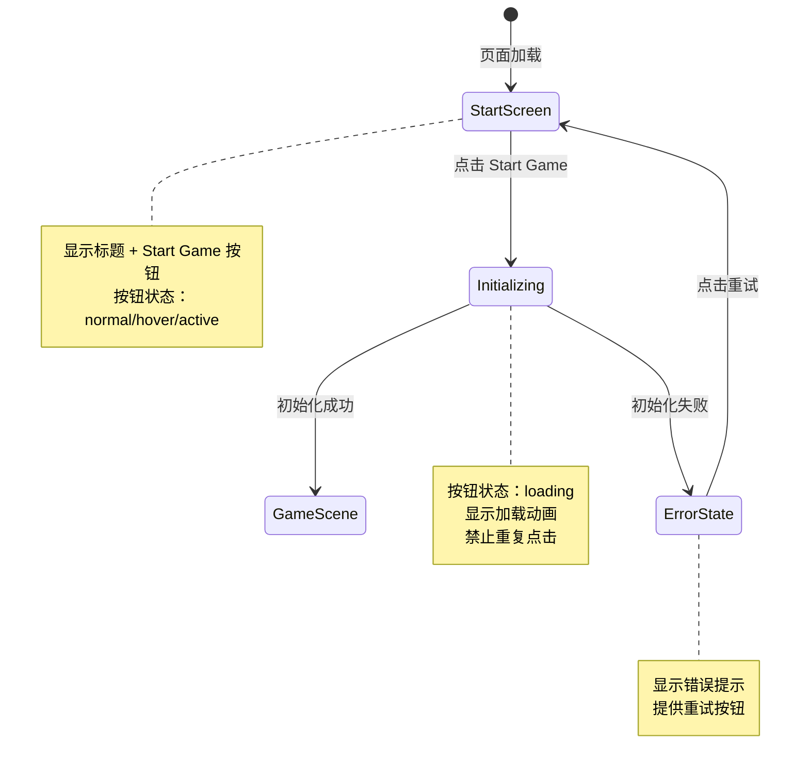

# UX 设计 — [BUG] Start Game 按钮点击无响应 - 事件监听器未绑定

> 所属需求：[BUG修复] Start Game 按钮点击无响应 - 事件监听器未绑定

## 交互流程图


```

## 组件线框说明

## 开始界面（Start Screen）

### 布局结构
```
┌─────────────────────────────────────┐
│                                     │
│         [游戏标题区域]              │
│      Platform Adventure             │
│                                     │
│                                     │
│        [开始按钮区域]               │
│       ┌─────────────────┐          │
│       │  Start Game     │          │
│       └─────────────────┘          │
│                                     │
│                                     │
│      [错误提示区域]（可选）         │
│                                     │
└─────────────────────────────────────┘
```

### 组件清单
1. **标题文本组件**（h1）
   - 内容："Platform Adventure"
   - 位置：垂直居中偏上

2. **开始按钮**（#start-btn）
   - 文本："Start Game"
   - 位置：标题下方，水平居中
   - 交互：点击触发游戏初始化

3. **错误提示组件**（可选，初始隐藏）
   - 位置：按钮下方
   - 包含：错误图标 + 错误文本 + 重试按钮

4. **加载指示器**（初始隐藏）
   - 位置：按钮内部或按钮下方
   - 类型：spinner 或进度动画

## 交互状态定义

## Start Game 按钮状态

### 1. 默认状态（normal）
- 显示文本："Start Game"
- 可点击
- 视觉：正常按钮样式

### 2. 悬停状态（hover）
- Web 端鼠标悬停时触发
- 视觉反馈：轻微高亮或边框变化
- cursor: pointer

### 3. 按下状态（active）
- 点击瞬间触发
- 视觉：scale(0.95) + 亮度降低
- 持续时间：100-150ms

### 4. 加载状态（loading）
- 点击后立即进入
- 显示：loading spinner + "Loading..." 文本
- 禁止重复点击（pointer-events: none）
- 视觉：opacity 0.7

### 5. 禁用状态（disabled）
- 游戏初始化失败或资源未加载完成时
- opacity: 0.5
- cursor: not-allowed
- 不响应任何交互

### 6. 错误状态（error）
- 初始化失败后显示
- 按钮文本变为："Retry"
- 下方显示错误提示文字
- 可重新点击触发重试

## 错误提示组件状态

### 1. 隐藏状态（默认）
- display: none
- 初始加载时不显示

### 2. 显示状态（error）
- 从下方 fade in（200ms）
- 包含：
  - 错误图标（warning icon）
  - 错误文本（"Failed to start game. Please try again."）
  - 可选：详细错误信息（开发模式）

## 页面级状态

### 1. 初始加载
- 显示完整开始界面
- 按钮处于 normal 状态

### 2. 游戏启动中
- 按钮进入 loading 状态
- 可选：全屏半透明遮罩 + 居中 spinner

### 3. 启动失败
- 按钮恢复可点击（显示 Retry）
- 错误提示组件显示
- 提供重试机制

## 响应式/适配规则

## 断点定义
- **Mobile**: < 768px
- **Tablet**: 768px - 1024px
- **Desktop**: > 1024px

## Mobile（< 768px）
- 标题字号：相对较小
- 按钮宽度：80% 屏幕宽度，最大 300px
- 按钮高度：48px（适合触摸）
- 垂直间距：标题与按钮间距 40px
- 错误提示：全宽显示，padding 16px

## Tablet（768px - 1024px）
- 标题字号：中等
- 按钮宽度：固定 320px
- 按钮高度：56px
- 垂直间距：标题与按钮间距 60px
- 错误提示：最大宽度 400px，居中

## Desktop（> 1024px）
- 标题字号：较大
- 按钮宽度：固定 360px
- 按钮高度：64px
- 垂直间距：标题与按钮间距 80px
- 错误提示：最大宽度 500px，居中
- hover 效果：启用（移动端不需要）

## 通用规则
- 所有元素水平居中对齐
- 使用 flexbox 实现垂直居中布局
- 最小安全区域：上下左右各 20px padding
- 按钮触摸区域：最小 44x44px（移动端）
- 动画性能：使用 transform 和 opacity（GPU 加速）

## UI 资产清单（初稿）

## 图标（Icons）

### 1. 加载图标
- **用途**：按钮 loading 状态
- **风格**：spinner / circular progress
- **尺寸**：24px
- **格式**：SVG 或 CSS 动画
- **颜色**：与按钮文字颜色一致

### 2. 错误图标
- **用途**：错误提示组件
- **风格**：warning / alert triangle
- **尺寸**：32px
- **格式**：SVG
- **颜色**：错误红色（#E53E3E 或主题色）

### 3. 重试图标（可选）
- **用途**：重试按钮
- **风格**：refresh / reload
- **尺寸**：20px
- **格式**：SVG
- **位置**：按钮文字左侧

## 插画（Illustrations）

### 1. 背景装饰（可选）
- **用途**：开始界面背景元素
- **描述**：平台跳跃游戏风格的简化场景（云朵、山峰、平台剪影）
- **尺寸**：全屏背景，响应式
- **格式**：SVG 或 PNG
- **风格**：扁平化、低饱和度（不抢主要内容焦点）

## 图片（Images）

### 1. 游戏 Logo（可选）
- **用途**：标题上方的品牌标识
- **尺寸**：120x120px（移动端）/ 160x160px（桌面端）
- **格式**：PNG 或 SVG
- **要求**：透明背景

## 动画资源

### 1. 按钮点击波纹效果
- **类型**：CSS ripple effect 或 Lottie 动画
- **时长**：300ms
- **触发**：按钮点击时

### 2. 页面过渡动画
- **类型**：fade out（开始界面消失）
- **时长**：400ms
- **缓动**：ease-out

## 字体（Fonts）

### 1. 标题字体
- **用途**："Platform Adventure" 标题
- **建议**：游戏风格字体（如 Press Start 2P / Orbitron）
- **备选**：系统无衬线字体（Arial / Helvetica）

### 2. 按钮字体
- **用途**：按钮文字
- **建议**：清晰易读的无衬线字体
- **粗细**：Medium / Semi-bold

## 颜色变量（仅供参考，非视觉设计）
- 主色（Primary）：按钮背景
- 错误色（Error）：#E53E3E
- 成功色（Success）：#38A169
- 中性色（Neutral）：文字、边框
