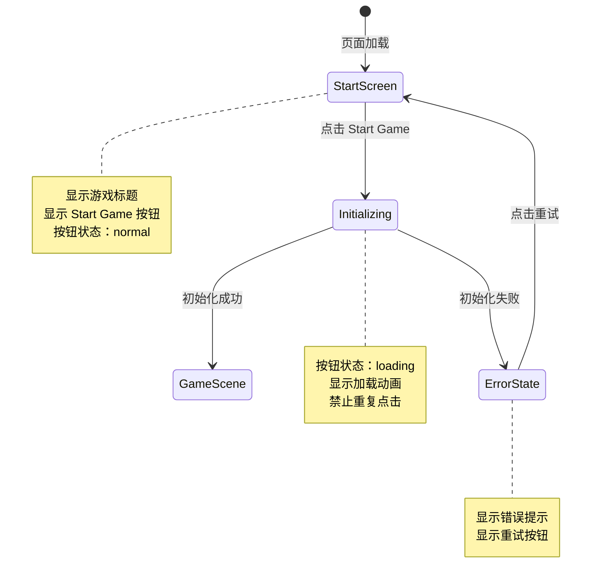

# UX 设计 — [BUG] Start Game 按钮点击无响应 - 事件监听器未绑定

> 所属需求：[BUG修复] Start Game 按钮点击无响应 - 事件监听器未绑定

## 交互流程图


```

## 组件线框说明

## 开始界面（Start Screen）

### 布局结构
```
┌─────────────────────────────────────┐
│                                     │
│         [游戏标题区域]              │
│      Platform Adventure             │
│                                     │
│                                     │
│       ┌─────────────────┐          │
│       │  Start Game     │          │
│       │  [主按钮]       │          │
│       └─────────────────┘          │
│                                     │
│                                     │
│      [版本号/版权信息]              │
└─────────────────────────────────────┘
```

### 组件清单
1. **标题文本（Title Text）**
   - 内容："Platform Adventure"
   - 位置：屏幕上方 1/3 处居中
   - 层级：装饰性，不可交互

2. **开始按钮（Start Button）**
   - ID: `#start-btn`
   - 文本："Start Game"
   - 位置：屏幕中央偏下
   - 尺寸：宽度 200-240px，高度 48-56px
   - 功能：点击后初始化游戏并进入游戏场景

3. **版本信息（Version Info）**
   - 内容：版本号或版权文字
   - 位置：屏幕底部居中
   - 层级：次要信息，不可交互

4. **加载指示器（Loading Spinner）**
   - 位置：按钮内部或按钮下方
   - 显示时机：点击按钮后，游戏初始化期间
   - 隐藏时机：进入游戏场景或出现错误

5. **错误提示（Error Toast）**
   - 位置：屏幕顶部或按钮下方
   - 内容：错误原因 + 重试引导
   - 显示时机：游戏初始化失败时

## 交互状态定义

## Start Game 按钮状态

### 1. 默认状态（normal）
- 显示：完整按钮，文本 "Start Game"
- 交互：可点击
- 视觉反馈：无
- 光标：pointer

### 2. 悬停状态（hover）- Web 端
- 显示：按钮保持完整
- 交互：可点击
- 视觉反馈：轻微高亮或边框变化
- 光标：pointer
- 过渡：150ms ease

### 3. 按下状态（active）
- 显示：按钮保持完整
- 交互：触发点击事件
- 视觉反馈：scale(0.95) + 亮度降低
- 持续时间：按下期间
- 过渡：100ms ease-out

### 4. 加载状态（loading）
- 显示：
  - 方案 A：按钮内文本替换为 spinner 动画
  - 方案 B：按钮文本变为 "Loading..." + 左侧 spinner
- 交互：禁止点击（pointer-events: none）
- 视觉反馈：旋转动画持续进行
- 光标：default 或 wait
- 触发时机：点击后立即进入，直到游戏场景加载完成

### 5. 禁用状态（disabled）
- 显示：按钮保持完整，透明度 0.4-0.5
- 交互：不可点击
- 视觉反馈：无
- 光标：not-allowed
- 使用场景：游戏资源未加载完成时（可选）

### 6. 错误状态（error feedback）
- 显示：按钮恢复 normal 状态
- 交互：可重新点击
- 附加元素：按钮下方显示错误提示文本
- 错误提示内容：
  - "Failed to start game. Please try again."
  - 或具体错误原因（网络错误/资源加载失败等）
- 错误提示样式：红色文本，小字号
- 自动消失：3-5 秒后淡出，或用户再次点击按钮时消失

---

## 页面级状态

### 初始加载状态
- 显示：完整 UI（标题 + 按钮）
- 按钮状态：normal（如果资源已就绪）或 disabled（资源加载中）
- 背景：游戏主题背景图或纯色

### 游戏初始化中
- 按钮状态：loading
- 其他元素：保持可见，可选添加全屏半透明遮罩
- 阻止操作：禁止点击其他区域

### 初始化失败
- 按钮状态：恢复 normal
- 错误提示：显示在按钮下方或屏幕顶部 toast
- 重试机制：用户可再次点击按钮重试

### 成功进入游戏
- 开始界面：淡出（fade out 300ms）
- 游戏场景：淡入或直接显示
- 按钮：不再可见

## 响应式/适配规则

## 响应式断点

### Mobile（< 768px）
- **布局**：单列垂直居中
- **标题**：字号缩小 20-30%，保持居中
- **按钮**：
  - 宽度：80% 屏幕宽度（最大 280px）
  - 高度：48px（适合触摸）
  - 位置：屏幕中央偏下（距底部 30-40%）
- **版本信息**：字号缩小，距底部 16px
- **触摸优化**：
  - 按钮最小触摸区域 44x44px
  - 移除 hover 状态（仅保留 active）
  - 点击反馈更明显（scale 0.92）

### Tablet（768px - 1024px）
- **布局**：保持垂直居中，元素间距增大
- **标题**：字号适中
- **按钮**：
  - 宽度：240px（固定）
  - 高度：52px
  - 位置：屏幕中央
- **版本信息**：距底部 24px
- **交互**：支持 hover 和 touch 双模式

### Desktop（> 1024px）
- **布局**：垂直居中，元素间距最大
- **标题**：字号最大
- **按钮**：
  - 宽度：240px
  - 高度：56px
  - 位置：屏幕中央
- **版本信息**：距底部 32px
- **交互**：完整 hover 效果，鼠标指针反馈

---

## 特殊适配

### 横屏模式（Landscape）
- 标题和按钮整体上移，避免被虚拟键盘遮挡
- 版本信息可隐藏或移至侧边

### 超小屏幕（< 375px 宽度）
- 按钮宽度：90% 屏幕宽度
- 标题字号进一步缩小
- 减少垂直间距

### 超大屏幕（> 1920px）
- 所有元素尺寸不再放大（设置 max-width）
- 保持在屏幕中央区域（最大 1200px 容器）

---

## 游戏画布适配
- 游戏画布（canvas）应在按钮点击后全屏显示
- 开始界面覆盖在画布之上（z-index 更高）
- 进入游戏时，开始界面淡出，画布接管全部交互

## UI 资产清单（初稿）

## 图标（Icons）

### 1. 加载图标（Loading Spinner）
- **用途**：按钮加载状态指示器
- **尺寸**：24x24px
- **风格**：circular spinner，游戏主题色或白色
- **动画**：360° 旋转，1s 循环
- **格式**：SVG 或 CSS 动画

### 2. 错误图标（Error Icon）- 可选
- **用途**：错误提示前的视觉标识
- **尺寸**：16x16px
- **风格**：感叹号或 X 符号，红色
- **格式**：SVG

### 3. 重试图标（Retry Icon）- 可选
- **用途**：错误状态下的重试按钮
- **尺寸**：20x20px
- **风格**：循环箭头，游戏主题色
- **格式**：SVG

---

## 插画（Illustrations）

### 1. 游戏 Logo/标题艺术字
- **用途**："Platform Adventure" 标题展示
- **尺寸**：建议 600x200px（可缩放）
- **风格**：像素风/卡通风，与游戏主题一致
- **格式**：PNG（透明背景）或 SVG

### 2. 背景装饰元素（可选）
- **用途**：开始界面背景氛围营造
- **内容**：游戏角色剪影、平台元素、云朵等
- **尺寸**：适配不同屏幕（建议 1920x1080 基准）
- **格式**：PNG 或 WebP

---

## 图片（Images）

### 1. 背景图（Background Image）
- **用途**：开始界面全屏背景
- **尺寸**：1920x1080px（16:9 比例）
- **内容**：游戏场景预览或抽象纹理
- **格式**：WebP（优先）或 JPG
- **优化**：移动端提供 1280x720 版本

### 2. 按钮背景纹理（可选）
- **用途**：按钮的纹理叠加层
- **尺寸**：可平铺的小图（如 64x64px）
- **格式**：PNG（透明）

---

## 字体（Fonts）

### 1. 标题字体
- **用途**："Platform Adventure" 标题
- **风格**：粗体、游戏感强（如像素字体或卡通字体）
- **格式**：WOFF2
- **备选**：系统字体 fallback（Arial Black, Impact）

### 2. 按钮字体
- **用途**："Start Game" 按钮文本
- **风格**：清晰易读，中等粗细
- **格式**：WOFF2
- **备选**：系统字体（Arial, Helvetica）

---

## 音效（Audio）- 可选

### 1. 按钮点击音效
- **用途**：点击 Start Game 时播放
- **时长**：< 0.5s
- **格式**：MP3 或 OGG

### 2. 背景音乐（可选）
- **用途**：开始界面循环播放
- **时长**：30-60s 循环
- **格式**：MP3
- **音量**：默认静音或低音量，用户可控制

---

## 资产优先级

**P0（必需）**：
- Loading Spinner 图标
- 背景图（可用纯色替代）

**P1（重要）**：
- 游戏标题艺术字
- 错误图标

**P2（可选）**：
- 背景装饰元素
- 按钮纹理
- 音效
