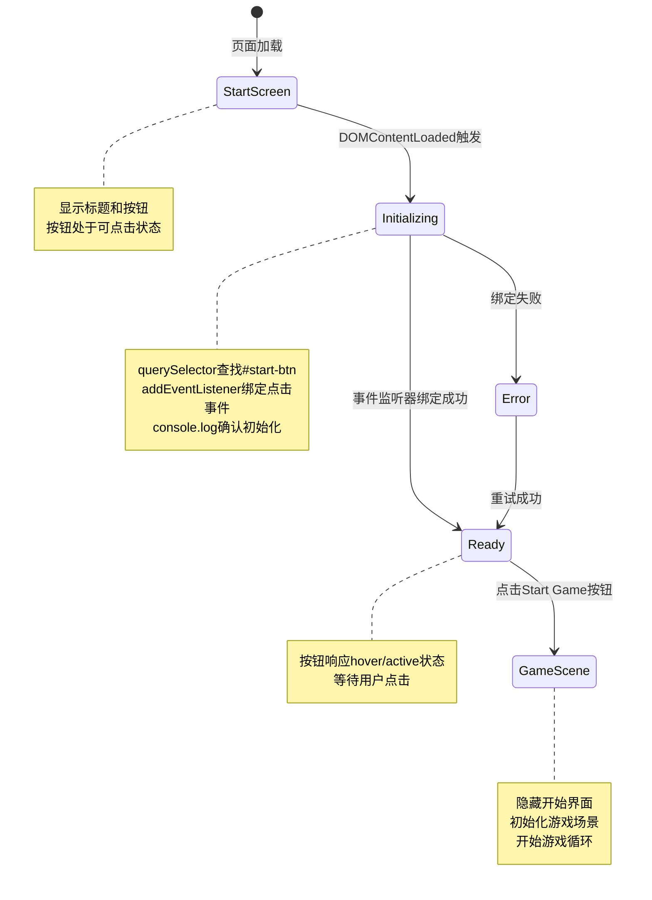

# UX 设计 — [BUG] Start Game 按钮点击无响应 - 事件监听器未绑定

> 所属需求：[BUG修复] Start Game 按钮点击无响应 - 事件监听器未绑定

## 交互流程图


```

## 组件线框说明

## 页面结构

### StartScreen（开始界面）
```
┌─────────────────────────────────────┐
│         [Game Container]            │
│                                     │
│     ┌─────────────────────┐        │
│     │  Platform Adventure │        │
│     │      (标题文字)      │        │
│     └─────────────────────┘        │
│                                     │
│     ┌─────────────────────┐        │
│     │    Start Game       │        │
│     │   (主操作按钮)       │        │
│     └─────────────────────┘        │
│                                     │
└─────────────────────────────────────┘
```

### 组件层级
- **Game Container** (`#game-container`)
  - **Title Text**：游戏标题，居中显示
  - **Start Button** (`#start-btn`)：主操作按钮，触发游戏开始

### DOM 结构要求
- 按钮必须在 DOMContentLoaded 后才能绑定事件
- 按钮元素必须有明确的 ID 选择器
- 容器需要支持后续游戏场景的渲染

## 交互状态定义

## Start Button (#start-btn)

### 状态定义
- **默认（normal）**
  - 可点击状态
  - 清晰可见
  - 鼠标指针为 pointer

- **悬停（hover）** [Web only]
  - 视觉反馈：轻微放大（scale 1.05）或亮度提升
  - 过渡动画：0.2s ease
  - 鼠标指针保持 pointer

- **按下（active）**
  - 视觉反馈：缩小（scale 0.95）
  - 过渡动画：0.1s ease-out
  - 模拟物理按压感

- **禁用（disabled）** [修复后不应出现]
  - opacity: 0.5
  - cursor: not-allowed
  - 不响应点击事件
  - 用于游戏加载中或初始化失败时

- **加载中（loading）** [可选优化]
  - 显示 spinner 或「Loading...」文字
  - 禁止重复点击
  - 用于游戏资源加载阶段

### 错误状态处理
- **初始化失败**
  - 按钮变为禁用状态
  - 显示错误提示：「初始化失败，请刷新页面」
  - Console 输出详细错误信息

- **事件绑定失败**
  - 按钮外观正常但无响应（当前 BUG 状态）
  - 修复方案：添加防御性检查和日志

## Title Text

### 状态定义
- **默认**：静态显示，无交互
- **加载中**：可选添加淡入动画（fade-in 0.5s）

## 页面级状态

### 初始化阶段
- **DOM 加载中**：空白或骨架屏
- **事件绑定中**：UI 可见但按钮未激活
- **就绪**：按钮可点击，等待用户操作

### 错误状态
- **脚本加载失败**：显示降级 UI + 刷新提示
- **DOM 查询失败**：Console 警告 + 按钮不可用
- **游戏初始化失败**：错误提示 + 重试按钮

## 响应式/适配规则

## 断点定义
- **Mobile**: < 768px
- **Tablet**: 768px - 1024px
- **Desktop**: > 1024px

## 布局规则

### Mobile (< 768px)
- 容器宽度：100vw
- 标题字号：相对单位（em/rem）
- 按钮宽度：80% 容器宽度，最大 300px
- 按钮高度：48px（符合触摸目标最小尺寸）
- 垂直间距：标题与按钮间距 40px
- 触摸优化：按钮 active 状态明显，无 hover 状态

### Tablet (768px - 1024px)
- 容器宽度：100vw 或固定画布尺寸
- 标题字号：适当放大
- 按钮宽度：60% 容器宽度，最大 400px
- 按钮高度：56px
- 垂直间距：标题与按钮间距 60px
- 支持 hover 状态（混合设备）

### Desktop (> 1024px)
- 容器宽度：游戏画布固定尺寸（如 800x600）或居中显示
- 标题字号：最大尺寸
- 按钮宽度：固定 320px
- 按钮高度：64px
- 垂直间距：标题与按钮间距 80px
- 完整 hover/active 状态

## 交互适配

### 触摸设备
- 移除 hover 状态（或使用 @media (hover: hover) 判断）
- 增强 active 状态视觉反馈
- 按钮最小尺寸 44x44px（iOS 规范）

### 鼠标设备
- 保留 hover 状态
- cursor: pointer 明确可点击
- 支持键盘导航（Tab 键聚焦 + Enter 触发）

## 性能优化
- 使用 CSS transform 实现缩放动画（GPU 加速）
- 避免 layout thrashing（批量 DOM 操作）
- 事件监听器使用 passive: true（滚动优化，此场景不适用）

## UI 资产清单（初稿）

## 图标 (Icons)

暂无图标需求（当前界面仅文字按钮）

### 可选优化图标
- **icon: play**
  - 用途：Start Game 按钮内前置图标
  - 尺寸：20x20px
  - 风格：filled 或 outline（与游戏整体风格一致）
  - 格式：SVG（支持缩放和主题色填充）

- **icon: refresh**
  - 用途：初始化失败时的重试按钮
  - 尺寸：24x24px
  - 风格：outline
  - 格式：SVG

## 插画 (Illustrations)

暂无插画需求

### 可选优化插画
- **illustration: game-loading**
  - 用途：游戏资源加载时的占位动画
  - 尺寸：200x200px
  - 风格：像素风格或扁平风格（匹配 Platform Adventure 主题）
  - 格式：SVG 动画或 GIF

## 图片 (Images)

暂无图片需求（纯色背景 + 文字界面）

### 可选优化图片
- **image: background**
  - 用途：开始界面背景（渐变或纹理）
  - 尺寸：1920x1080px（支持高分辨率屏幕）
  - 格式：WebP（优先）或 PNG
  - 备注：需提供 @2x 版本用于 Retina 屏幕

## 字体 (Fonts)

- **font: title**
  - 用途：「Platform Adventure」标题
  - 要求：支持英文，具有游戏感（如像素字体或粗体无衬线）
  - 格式：WOFF2（优先）
  - 备注：需 fallback 到系统字体（sans-serif）

- **font: button**
  - 用途：按钮文字
  - 要求：清晰易读，中等粗细
  - 格式：系统字体栈即可（-apple-system, BlinkMacSystemFont, 'Segoe UI'...）

## 动画资源 (Animations)

暂无外部动画资源需求（使用 CSS transition 实现）

## 音效 (Audio) [超出 UX 范畴，仅列出]

- **sound: button-click**
  - 用途：按钮点击反馈音
  - 格式：MP3 或 OGG
  - 时长：< 0.5s

## 资产优先级

### P0（修复 BUG 必需）
- 无（当前 BUG 为逻辑问题，不涉及资产）

### P1（体验优化）
- icon: play（按钮图标）
- font: title（游戏标题字体）

### P2（锦上添花）
- illustration: game-loading
- image: background
- sound: button-click
