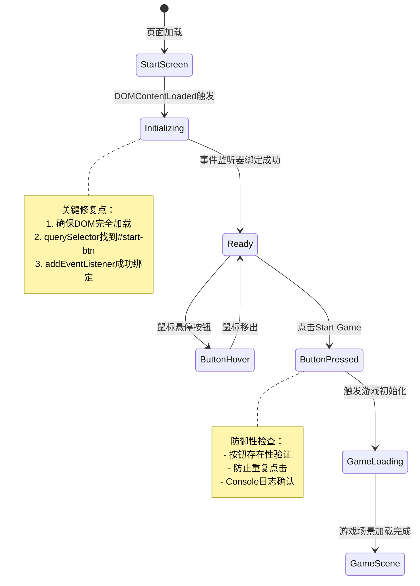

# UX 设计 — [BUG] Start Game 按钮点击无响应 - 事件监听器未绑定

> 所属需求：[BUG修复] Start Game 按钮点击无响应 - 事件监听器未绑定

## 交互流程图


```

## 组件线框说明

## 开始界面结构

### 主容器 (#start-screen)
- 全屏居中布局
- 垂直方向 flexbox

### 组件层级
```
#start-screen
├── .title-container
│   └── h1 "Platform Adventure"
│       - 游戏标题
│       - 居中对齐
│
└── .button-container
    └── button#start-btn
        - 文本："Start Game"
        - 主操作按钮
        - 居中对齐
```

### 关键 DOM 元素
- **#start-btn**（修复目标）
  - 必须在 DOMContentLoaded 后可查询
  - 需要绑定 click 事件监听器
  - 点击后触发游戏初始化函数

### 调试辅助元素（开发阶段）
- Console 日志输出点：
  1. DOMContentLoaded 触发确认
  2. querySelector 查询结果
  3. 事件监听器绑定确认
  4. 按钮点击事件触发确认

## 交互状态定义

## Start Game 按钮状态

### 1. 默认（normal）
- 可点击状态
- cursor: pointer
- 视觉：实心背景 + 白色文字

### 2. 悬停（hover）
- Web 端鼠标悬停时
- 视觉变化：背景亮度提升 10%
- transition: 0.2s ease

### 3. 按下（active）
- 鼠标按下或触摸时
- transform: scale(0.95)
- 视觉：背景亮度降低 10%
- transition: 0.1s ease

### 4. 禁用（disabled）
- 游戏加载中时自动禁用
- opacity: 0.5
- cursor: not-allowed
- pointer-events: none
- 防止重复点击

### 5. 加载中（loading）
- 点击后立即进入此状态
- 文本变为 "Loading..."
- 可选：添加旋转 spinner 图标
- 禁用点击事件

### 6. 错误（error）
- 游戏初始化失败时
- 按钮文本变为 "Retry"
- 背景色变为警告色
- 1.5s 后恢复为默认状态

## 页面级状态

### 初始化中（Initializing）
- DOMContentLoaded 触发后
- 事件监听器绑定过程
- Console 输出："Initializing game..."

### 就绪（Ready）
- 所有事件监听器绑定完成
- 按钮可交互
- Console 输出："Game ready, click Start to begin"

### 游戏加载中（Game Loading）
- 点击按钮后
- 开始界面可选淡出动画（fade-out 0.3s）
- 按钮进入 loading 状态

### 错误状态（Error）
- 游戏初始化失败
- 显示错误提示（Toast 或内联文本）
- 按钮变为 Retry 状态
- 提供重试机制

## 响应式/适配规则

## 响应式断点

### Mobile（< 768px）
- 开始界面全屏垂直居中
- 标题字号：相对单位（建议 2.5rem）
- 按钮宽度：80% 容器宽度，最大 300px
- 按钮高度：48px（符合触摸目标最小尺寸）
- 垂直间距：标题与按钮间距 40px

### Tablet（768px - 1024px）
- 标题字号：3rem
- 按钮宽度：60% 容器宽度，最大 400px
- 按钮高度：56px
- 垂直间距：标题与按钮间距 60px

### Desktop（> 1024px）
- 标题字号：4rem
- 按钮宽度：固定 400px
- 按钮高度：64px
- 垂直间距：标题与按钮间距 80px
- hover 效果启用（移动端禁用 hover）

## 交互适配

### 触摸设备
- 按钮最小触摸区域：44x44px（iOS 规范）
- 禁用 hover 伪类（通过 @media (hover: hover) 判断）
- active 状态反馈更明显（scale 0.92）

### 键盘导航
- 按钮支持 Tab 键聚焦
- 聚焦时显示 outline（2px 主色）
- Enter/Space 键触发点击

## 性能优化
- 使用 transform 而非 width/height 做动画（GPU 加速）
- 事件监听器使用 passive: true（滚动性能）
- 避免在 hover/active 时触发 reflow

## UI 资产清单（初稿）

## 图标（Icons）

### 1. Loading Spinner
- **用途**：按钮 loading 状态指示器
- **尺寸**：20x20px
- **风格**：简约圆环旋转动画
- **格式**：SVG 或 CSS 动画
- **颜色**：白色（叠加在按钮背景上）

### 2. Retry Icon（可选）
- **用途**：错误状态下的重试按钮图标
- **尺寸**：24x24px
- **风格**：圆形箭头（顺时针）
- **格式**：SVG
- **颜色**：继承按钮文字颜色

## 插画（Illustrations）

### 1. Error State Illustration（可选）
- **用途**：游戏初始化失败时显示
- **描述**：简约的错误提示图（如断开的插头/感叹号）
- **尺寸**：200x200px
- **风格**：扁平化，与游戏主题一致
- **位置**：按钮上方或替换标题区域

## 背景资源（Backgrounds）

### 1. Start Screen Background
- **用途**：开始界面背景
- **尺寸**：响应式（cover 模式）
- **建议**：渐变色或低饱和度游戏场景截图
- **格式**：WebP（备用 JPG）
- **优化**：< 200KB

## 调试资源（开发阶段）

### 1. Console 日志图标（可选）
- **用途**：开发模式下在页面显示初始化状态
- **类型**：文本标签或小型状态指示器
- **位置**：页面右下角
- **内容**：
  - ✅ DOM Loaded
  - ✅ Event Bound
  - ✅ Ready to Start

## 字体资源

### 游戏标题字体
- **要求**：支持英文，具有游戏感
- **备选方案**：系统字体栈（'Press Start 2P', monospace, sans-serif）
- **加载策略**：font-display: swap（避免 FOIT）

## 音效资源（可选）

### 1. Button Click Sound
- **用途**：按钮点击反馈
- **格式**：MP3/OGG
- **时长**：< 0.5s
- **音量**：可配置（默认 50%）

### 2. Error Sound
- **用途**：初始化失败提示
- **格式**：MP3/OGG
- **时长**：< 1s

---

## 资源加载优先级

**关键路径（必须同步加载）**：
- #start-btn DOM 元素
- 事件监听器脚本

**次要资源（可延迟加载）**：
- 背景图片
- 自定义字体
- 音效文件

**开发调试资源（生产环境移除）**：
- Console 日志
- 状态指示器
