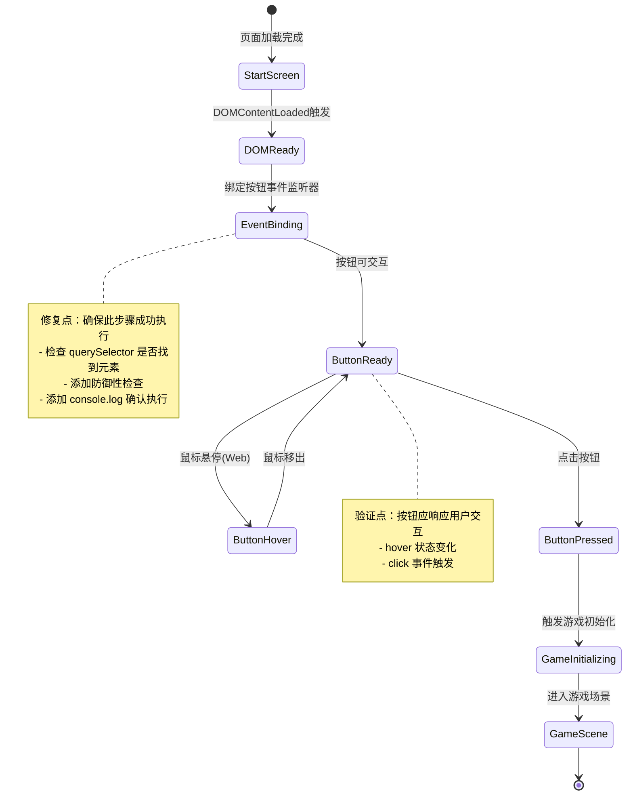

# UX 设计 — [BUG] Start Game 按钮点击无响应 - 事件监听器未绑定

> 所属需求：[BUG修复] Start Game 按钮点击无响应 - 事件监听器未绑定

## 交互流程图


```

## 组件线框说明

## 开始界面结构

### 主容器 (#start-screen)
- 全屏居中布局
- 垂直方向排列

#### 1. 标题区域
- 游戏标题文本："Platform Adventure"
- 位置：屏幕上方 1/3 处
- 对齐：水平居中

#### 2. 按钮区域
- 开始按钮 (#start-btn)
  - 文本："Start Game"
  - 位置：标题下方，垂直居中偏下
  - 对齐：水平居中
  - 尺寸：足够大以便点击（建议最小 44x44px 触摸区域）

### DOM 结构示意
```
<div id="start-screen">
  <h1>Platform Adventure</h1>
  <button id="start-btn">Start Game</button>
</div>
```

### 布局要点
- 使用 flexbox 实现垂直居中
- 按钮与标题之间保持适当间距（建议 48-64px）
- 确保按钮在所有设备上易于点击

## 交互状态定义

## Start Game 按钮状态

### 1. 默认状态 (normal)
- 按钮可见且可点击
- 显示 "Start Game" 文本
- 光标：pointer
- **验证**：元素存在于 DOM 中，事件监听器已绑定

### 2. 悬停状态 (hover) - Web 端
- 触发条件：鼠标指针移入按钮区域
- 视觉反馈：轻微缩放（scale 1.05）或亮度变化
- 光标：pointer
- **验证**：CSS :hover 伪类生效

### 3. 按下状态 (active/pressed)
- 触发条件：鼠标按下或触摸按下
- 视觉反馈：缩小（scale 0.95）+ 亮度降低
- 持续时间：按下期间
- **验证**：CSS :active 伪类生效

### 4. 点击响应状态 (clicked)
- 触发条件：完整点击操作（mousedown + mouseup）
- 行为：
  - 触发 click 事件监听器
  - 执行游戏初始化函数
  - 过渡到游戏场景
- **验证**：Console 输出初始化日志，场景切换成功

### 5. 禁用状态 (disabled) - 可选
- 触发条件：游戏正在加载资源时
- 视觉：opacity 0.5
- 行为：不响应点击，光标 not-allowed
- **使用场景**：防止重复点击导致多次初始化

### 6. 加载状态 (loading) - 可选增强
- 触发条件：点击后，游戏资源加载中
- 视觉：按钮文本变为 "Loading..." 或显示 spinner
- 行为：禁用点击
- 持续时间：直到游戏场景准备完成

## 页面级状态

### 初始化状态
- **DOM 未就绪**：页面 HTML 解析中，按钮不可交互
- **DOM 就绪**：DOMContentLoaded 触发，事件监听器绑定完成
- **完全加载**：所有资源（图片/字体）加载完成

### 错误状态（防御性）
- **按钮元素不存在**：querySelector 返回 null
  - 处理：Console 输出警告，不绑定事件
- **游戏初始化失败**：资源加载错误
  - 处理：显示错误提示，提供重试按钮

## 响应式/适配规则

## 响应式断点

### Mobile (< 768px)
- 按钮宽度：80% 视口宽度，最大 300px
- 按钮高度：最小 48px（符合移动端触摸标准）
- 标题字号：相对较小（建议 viewport 单位）
- 垂直间距：标题与按钮间距 32-48px
- 触摸区域：确保按钮周围有足够空白（最小 8px padding）

### Tablet (768px - 1024px)
- 按钮宽度：60% 视口宽度，最大 400px
- 按钮高度：最小 52px
- 标题字号：中等尺寸
- 垂直间距：标题与按钮间距 48-64px
- 支持 hover 状态（部分平板支持鼠标）

### Desktop (> 1024px)
- 按钮宽度：固定宽度 320-400px
- 按钮高度：56-64px
- 标题字号：最大尺寸
- 垂直间距：标题与按钮间距 64-80px
- 完整 hover/active 状态支持
- 键盘支持：Enter/Space 键触发按钮

## 布局适配规则

### 纵横比适配
- **横屏（landscape）**：标题和按钮水平排列（可选）
- **竖屏（portrait）**：保持垂直居中布局

### 安全区域
- 移动端：考虑刘海屏/底部手势条，使用 safe-area-inset
- 按钮距离屏幕底部：最小 24px（避免误触）

### 触摸优化
- 所有可点击元素最小尺寸：44x44px（iOS 标准）
- 按钮周围留白：最小 8px，避免误触相邻元素

### 性能考虑
- 使用 CSS transform 实现动画（GPU 加速）
- 避免在移动端使用复杂 hover 效果（性能问题）

## UI 资产清单（初稿）

## 图标需求

### 1. 加载指示器（可选增强）
- **用途**：按钮 loading 状态显示
- **类型**：spinner / 旋转圆环
- **尺寸**：24x24px
- **风格**：简约，与游戏主题匹配
- **颜色**：单色（由 CSS 控制）
- **格式**：SVG（可缩放）

### 2. 播放/开始图标（可选）
- **用途**：按钮内文本前的装饰图标
- **类型**：播放三角形 / 右箭头
- **尺寸**：20x20px
- **风格**：outline 或 filled，游戏风格
- **格式**：SVG

## 插画需求

### 1. 背景装饰（可选）
- **用途**：开始界面背景氛围营造
- **描述**：平台跳跃游戏元素（平台剪影/角色剪影/云朵）
- **尺寸**：全屏背景，响应式
- **风格**：简约扁平 / 像素风（根据游戏主题）
- **格式**：SVG（矢量）或 WebP（位图）

## 字体需求

### 1. 标题字体
- **用途**："Platform Adventure" 标题显示
- **风格**：游戏感强，易读性好
- **建议**：像素字体 / 粗体无衬线 / 手写体
- **格式**：WOFF2（Web 优化）
- **备用**：系统字体 fallback

### 2. 按钮字体
- **用途**："Start Game" 按钮文本
- **风格**：清晰易读，与标题协调
- **建议**：中等粗细无衬线字体
- **格式**：WOFF2

## 音效需求（游戏 UI 特有）

### 1. 按钮点击音效
- **用途**：点击 Start Game 按钮时播放
- **描述**：短促清脆的确认音（50-200ms）
- **格式**：MP3 / OGG（跨浏览器兼容）
- **音量**：中等，可配置

### 2. 悬停音效（可选）
- **用途**：鼠标悬停按钮时播放
- **描述**：轻微的提示音（30-100ms）
- **格式**：MP3 / OGG

## 资产优先级

### P0（必需，修复 Bug 所需）
- 无（当前 Bug 修复仅需代码层面，无 UI 资产依赖）

### P1（基础体验）
- 标题字体（若使用自定义字体）
- 按钮点击音效（游戏 UI 标配）

### P2（增强体验）
- 背景装饰插画
- Loading spinner 图标
- 悬停音效

## 资产规格说明

### 图片导出规范
- **分辨率**：@1x, @2x, @3x（支持高清屏）
- **格式优先级**：WebP > PNG > JPEG
- **压缩**：TinyPNG 或类似工具优化

### 音频规范
- **采样率**：44.1kHz
- **比特率**：128kbps（音效）
- **声道**：单声道（节省空间）
- **格式**：提供 MP3 + OGG 两种格式（兼容性）
